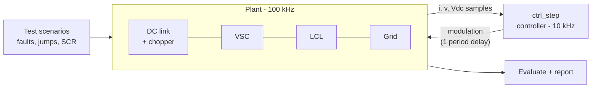

# grid-inverter-frt-sim

Grid-connected 3-phase inverter with fault ride-through control in MATLAB: PLL, dq current control, an automated fault test bench and SIL validation.


[](https://github.com/salmansystech/grid-inverter-frt-sim/actions/workflows/test-matrix.yml)


## What this is

The project models a 10 kVA solar/battery inverter feeding the 400 V grid, together with the controller that keeps it connected when the grid voltage collapses during a fault. It is built like a **hardware-in-the-loop test rig in software**:

- a **plant model** of the power stage and grid: LCL filter, DC link, brake chopper, and a grid with adjustable strength;
- a **controller under test** written as a single code-generatable function, the way it would run on a DSP every 100 µs;
- an **automated test bench** that applies grid faults, phase jumps and frequency steps, checks the response against limits written in grid-code style, and writes a report.

This is the same workflow used to validate converter controls on real-time simulators such as RTDS: the plant runs in the simulator, the controller runs on its own hardware, and scripted test sequences verify fault behaviour.

## Features

| Area | Implementation |
|---|---|
| Grid synchronisation | DSOGI positive-sequence extraction and an amplitude-normalised SRF-PLL, with reduced bandwidth during faults for weak-grid stability |
| Current control | dq PI, cross-coupling decoupling, PCC voltage feedforward, 1.5·Ts delay compensation, SVPWM voltage limit with anti-windup |
| Outer loops | DC-link voltage PI, reactive power command, current limiter with active or reactive priority |
| Fault ride-through | Dip detection with hysteresis, reactive current injection curve (K = 2), PWM brake chopper, ramped active power recovery |
| Plant | Exact ZOH-discretised LCL with passive damping, Thevenin grid set by SCR, DC-link energy balance |
| Testing | 11 scenarios (symmetric and asymmetric dips down to 5%, phase jump, frequency step, weak grid), 17 metrics, Markdown report, CI on every push |
| Code generation | MATLAB Coder: standalone C library and a SIL equivalence check of generated code against the model |

## Quick start

You need MATLAB R2020a or newer. Base MATLAB is enough for the simulations; `run_sil` also needs MATLAB Coder. [MATLAB Online](https://matlab.mathworks.com) works too.

```matlab
cd grid-inverter-frt-sim
addpath scripts

run_demo                     % one scenario (50 % dip) with plots
run_demo('asym_1ph_20')      % any scenario by name
run_test_matrix              % all scenarios -> results/report.md + PNGs
run_sil                      % generate C code + SIL equivalence (MATLAB Coder)
```

The full test matrix, including plots, takes about a minute or two.

## Architecture



See [docs/ARCHITECTURE.md](docs/ARCHITECTURE.md) for the module map, timing model, controller block diagram, interfaces, and how this maps to RTDS-based HIL.

## Test matrix

| Scenario | Event | Key checks |
|---|---|---|
| `steady_state` | Start-up, 10 kW export | P and Vdc error, no oscillation |
| `q_step` | 0 → 5 kvar at full power | Q settling time, current limit |
| `sym_dip_50` / `_20` / `_05` | 3-phase dip, 150 ms | i_q rise ≤ 30 ms, curve tracking, Vdc ≤ 1.15 pu, P recovery ≤ 100 ms |
| `asym_1ph_20`, `asym_2ph_50` | Unbalanced dips | Same, plus bounded negative-sequence current |
| `phase_jump_20` | +20° jump | PLL re-lock ≤ 100 ms |
| `freq_step` | 50 → 49.5 Hz | Frequency tracking ≤ 150 ms, zero steady-state error |
| `weak_scr3`, `weak_scr3_dip50` | SCR = 3 | Stability and FRT on a weak grid |

The definitions and the reasoning behind each limit are in [docs/TEST_PLAN.md](docs/TEST_PLAN.md).

## Design notes

[docs/CONTROL_DESIGN.md](docs/CONTROL_DESIGN.md) shows how every gain is calculated from the plant parameters. It also records two problems the test bench found and how they were fixed:

1. **PLL loss of lock on a weak grid during faults.** Injecting reactive current at low voltage into an SCR-3 grid caused an 18 Hz PLL oscillation. The fix was to cut the PLL bandwidth to 25% while FRT is active.
2. **DC chopper limit cycle.** An on/off hysteresis chopper made the DC voltage oscillate, and this coupled into the grid voltage. A PWM (proportional) chopper fixed it.

## Project structure

```
grid-inverter-frt-sim/
├── src/
│   ├── params/      default_params.m      ratings, plant, derived controller gains
│   ├── plant/       LCL + grid model, DC link, sensor interface, transforms
│   ├── control/     ctrl_init.m, ctrl_step.m  (code-generatable controller)
│   ├── sim/         run_simulation.m      multi-rate closed loop
│   └── analysis/    metrics, plots, report
├── tests/           scenarios.m           test matrix and criteria
├── scripts/         run_demo, run_test_matrix, run_sil
├── docs/            architecture, control design, test plan, developer guide, future work
├── results/         generated report and plots (git-ignored)
└── .github/         CI: runs the test matrix on every push
```

## Documentation

| Document | Contents |
|---|---|
| [Architecture](docs/ARCHITECTURE.md) | System and module structure, timing model, controller block diagram, interfaces, V-model and HIL mapping |
| [Control design](docs/CONTROL_DESIGN.md) | Plant equations, tuning of every loop, FRT strategy, known limitations |
| [Test plan](docs/TEST_PLAN.md) | Scenarios, metric definitions, limits and their rationale |
| [Developer guide](docs/DEVELOPER_GUIDE.md) | Setup, commands, coding rules, how to add scenarios, metrics and features, debugging, CI |
| [Future work](docs/FUTURE_WORK.md) | Roadmap from Simulink and switching models to grid-forming control, PIL and real-time HIL |

## Roadmap

Highlights from [docs/FUTURE_WORK.md](docs/FUTURE_WORK.md):

- [ ] Simulink harness: the same `ctrl_step` inside a MATLAB Function block, with the plant in Simscape Electrical and a switching model for THD analysis
- [ ] Grid-forming control (droop or virtual synchronous machine) compared with grid-following
- [ ] Dual-sequence current control for negative-sequence injection in unbalanced faults
- [ ] Active damping of the LCL resonance instead of the passive resistor
- [ ] PIL on an STM32 (generated C on target, plant in MATLAB)
- [ ] Real-time HIL on OPAL-RT, Typhoon or RTDS

## License

MIT. See [LICENSE](LICENSE).
