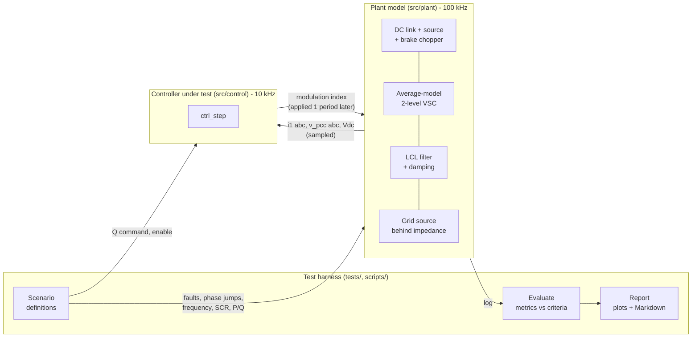
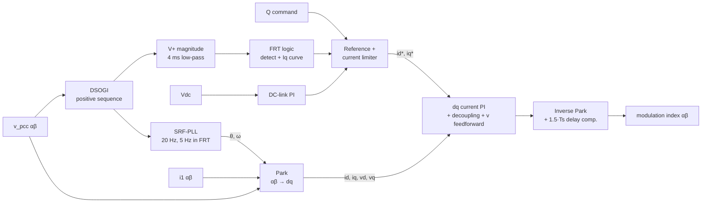

# Architecture

This project is laid out like a hardware-in-the-loop (HIL) test rig, built entirely in software. The **plant** (power stage and grid) and the **controller under test** are separate modules that only exchange the signals a real control card would see. A **test harness** drives grid events and judges the response.

## System overview



The same split appears on an RTDS rig: the RTDS solves the grid and power stage in real time, and the real controller is connected through analogue/digital I/O. Here `run_simulation` plays the role of the real-time simulator, and `ctrl_step` (or its generated C code) is the controller.

## Physical system

```
   DC source          2-level VSC          LCL filter                    Grid
  (PV/battery)        (average model)
                                         L1        L2       Lg, Rg
  P_src ──►┬── Cdc ──► [ m·Vdc ] ──i1──►─∿∿∿─┬─►─∿∿∿─i2──►─∿∿∿───( vs )
           │                                 │                    dips, phase
          [Rch]  brake chopper              Cf                    jumps, f steps
           │     (PWM, 1.08–1.12 pu)         │
                                            Rd   ◄── PCC: measured voltage
```

| Quantity | Value |
|---|---|
| Rating | 10 kVA, 400 V line-to-line, 50 Hz |
| DC link | 750 V, 2 mF, 40 Ω PWM brake chopper |
| LCL | L1 = 5 mH, Cf = 10 µF with Rd = 4 Ω, L2 = 2 mH |
| Grid | Thevenin source, SCR 20 (stiff) or 3 (weak), X/R = 10 |
| Base values | 1 pu voltage = 326.6 V phase peak, 1 pu current = 20.41 A peak |

## Module map

| Layer | File | Responsibility |
|---|---|---|
| Parameters | `src/params/default_params.m` | Ratings, plant values, timing, and **all controller gains derived from the plant** |
| Plant | `src/plant/plant_init.m` | Builds the LCL + grid state-space model and discretises it exactly (ZOH via `expm`) |
| | `src/plant/plant_step.m` | One 10 µs plant step: AC states, DC-link energy balance, chopper |
| | `src/plant/plant_meas.m` | The sensor interface: what a control card can sample |
| | `src/plant/grid_source.m` | Three-phase source with per-phase dips and phase offset |
| | `src/plant/clarke.m`, `inv_clarke.m` | Amplitude-invariant transforms |
| Controller | `src/control/ctrl_init.m` | Fixed-type controller state (all scalars) |
| | `src/control/ctrl_step.m` | One 100 µs control period, written for code generation |
| Simulation | `src/sim/run_simulation.m` | Multi-rate loop, sampling and PWM delay, logging |
| | `src/sim/scenario_inputs.m` | Time-varying stimuli of a scenario |
| Analysis | `src/analysis/evaluate_scenario.m` | Metrics and pass/fail checks |
| | `src/analysis/plot_scenario.m` | Six-panel overview figure |
| | `src/analysis/write_report.m` | `results/report.md` |
| Tests | `tests/scenarios.m`, `tests/make_scenario.m` | The test matrix and its criteria |
| Entry points | `scripts/run_test_matrix.m` | Runs everything (used by CI) |
| | `scripts/run_demo.m` | Runs one scenario interactively |
| | `scripts/run_sil.m` | Code generation and SIL equivalence check |

## Timing and execution model

Two rates are used, as in a real converter:

| Rate | Period | What runs |
|---|---|---|
| Plant | 10 µs (100 kHz) | LCL + grid states, DC link, chopper |
| Control | 100 µs (10 kHz) | `ctrl_step`, the same as a DSP interrupt synchronised to the PWM |

Within one control period:

```
 t_k                                    t_k+1                                  t_k+2
  │ sample i1, v_pcc, Vdc               │ new modulation index active          │
  │ run ctrl_step  → m(k)               │ (PWM register update)                │
  │ plant: 10 sub-steps with m(k-1) ────┼─ plant: 10 sub-steps with m(k) ──────┤
```

The modulation index computed from samples at `t_k` takes effect at `t_k+1`. Adding the half-period average delay of the PWM gives a total of **1.5 Ts** of delay. The controller compensates by rotating its output voltage forward by `1.5·ω·Ts` before the inverse Park transform. Modelling this delay matters: without it the current loop looks far more stable in simulation than it would be on hardware.

## Controller structure



The design behind each block is described in [CONTROL_DESIGN.md](CONTROL_DESIGN.md).

## Interfaces

The controller interface is deliberately the same as what a real control card would have, which is why it can be code-generated unchanged:

```matlab
[s, y] = ctrl_step(s, meas, ref, c)
%  s     state struct, fixed types (from ctrl_init)
%  meas  .i_ab [2x1] A   .v_ab [2x1] V   .vdc V        -> ADC samples
%  ref   .q var          .enable 0/1                   -> plant controller / SCADA
%  c     parameter struct (compile-time constant in generated code)
%  y     .m_ab [2x1] modulation index                  -> PWM peripheral
%        + internal signals for logging
```

Design rules applied to `ctrl_step`:
- **No dynamic memory and no variable-size data.** The state is a struct of scalars.
- **No toolbox calls.** It uses only arithmetic, `sqrt`, `sin`, `cos`, `mod`, `min` and `max`.
- **Parameters are passed in, never global.** `run_sil` turns them into compile-time constants with `coder.Constant`.
- **One function, one period.** This is the shape of an interrupt service routine.

## Verification flow (V-model)

```
  Requirements (grid-code style)              Acceptance: test matrix
  docs/TEST_PLAN.md          ─────────────►   scripts/run_test_matrix.m
        │                                              ▲
        ▼                                              │
  Control design                               SIL: generated C == model
  docs/CONTROL_DESIGN.md     ─────────────►   scripts/run_sil.m
        │                                              ▲
        ▼                                              │
  Implementation                               MIL: closed-loop simulation
  src/control/ctrl_step.m    ─────────────►   src/sim/run_simulation.m
```

| Stage | What runs | Status |
|---|---|---|
| MIL (model-in-the-loop) | `ctrl_step.m` against the plant model | Implemented |
| SIL (software-in-the-loop) | Generated C (as MEX) against the same plant, compared sample by sample | Implemented, needs MATLAB Coder |
| PIL (processor-in-the-loop) | Generated C on an MCU (e.g. STM32), plant in MATLAB | Roadmap, needs hardware |
| HIL (hardware-in-the-loop) | Plant on a real-time simulator (RTDS, OPAL-RT, Typhoon), controller on hardware | Mapping described above |

## Key design decisions

| Decision | Reason |
|---|---|
| Average converter model instead of switching | 10 kHz switching ripple doesn't change control-loop behaviour at these bandwidths, and a run takes seconds instead of minutes. A switching model is on the roadmap for THD work. |
| Exact ZOH discretisation of the LCL | Stable and accurate at a 10 µs step, without a stiff ODE solver |
| Controller in a MATLAB function, not Simulink blocks | Plain text that diffs and reviews well, runs in CI, and can be code-generated directly. The same function can be dropped into a Simulink *MATLAB Function* block unchanged. |
| Converter-side current control with passive damping | Robust to a wide range of grid impedances (SCR 3 to 20) without retuning |
| Thevenin grid with SCR parameter | Allows a single parameter to sweep from a stiff to a weak grid |
| Criteria in data, not in code | Adding a scenario or tightening a limit is a one-line change in `tests/scenarios.m` |
